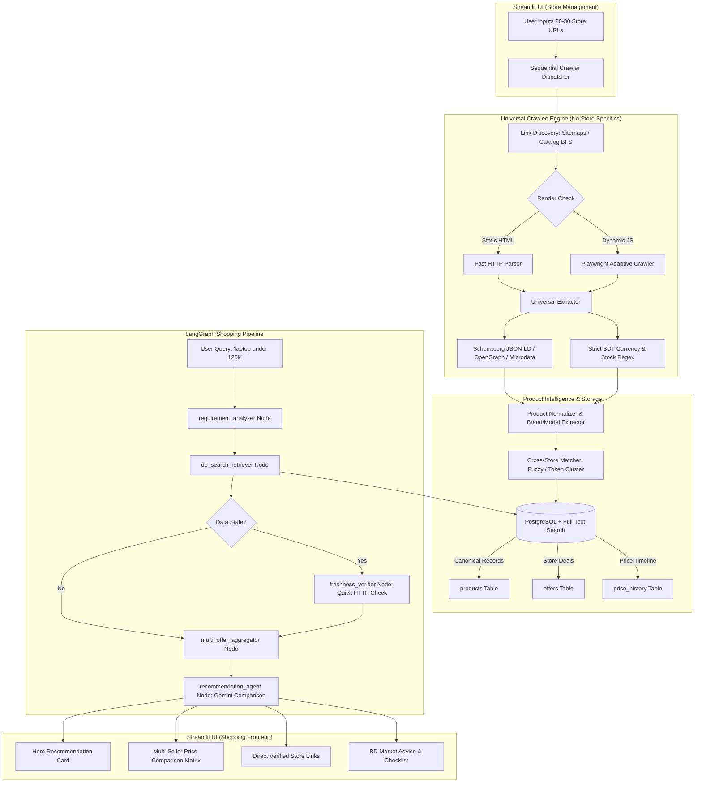

# Bangladesh AI Shopping Assistant: Next-Generation Hybrid Architecture & Upgrade Master Plan

## 1. Executive Summary & Strategic Shift

### The Core Problem Solved
The current implementation relies on ephemeral runtime search queries via DuckDuckGo and Jina Reader. While functional for ad-hoc queries, this approach suffers from:
1. **Search engine rate limits & latency** (fetching 10 candidate pages live takes 15–30 seconds per user query).
2. **Stale search engine snippets** (search engine caches often show outdated prices or out-of-stock items).
3. **Fragmented store comparisons** (the same physical product across 3 different stores is presented as 3 separate, unrelated products rather than 1 product with competing store offers).

### The New Architecture
This upgrade transforms the system into a **high-speed, local-first hybrid architecture**:
- **Zero Search Engine Dependency**: Direct crawling of 20–30 user-defined Bangladeshi e-commerce stores.
- **Universal, Zero-Store-Specific Extraction**: Schema.org JSON-LD, OpenGraph, Microdata, and generalized semantic DOM parsers that adapt to any Bangladeshi store without writing custom per-store scrapers.
- **Dual Data Model (`Product` vs. `Offer`)**: Consolidates identical products across different stores under one canonical card displaying live price comparisons (e.g. Star Tech ৳115,000 vs. Ryans ৳118,000 vs. TechLand ৳116,500).
- **LangGraph Kept & Elevated**: Powers query decomposition, database retrieval, price-performance ranking, freshness verification, and natural language advice in Bangla, English, and Banglish.
- **Streamlit Store Manager**: Dedicated UI dashboard to input, manage, and sequentially crawl 20–30 stores with live progress bars and data metrics.

---

## 2. High-Level Architecture & Workflow



---

## 3. Database Schema Design (Dual-Model Architecture)

To compare prices across multiple sellers accurately without inventory duplication, we maintain separate relational entities for **canonical products** and **store-specific offers**.

```sql
-- 1. Stores configured via Streamlit UI (20-30 stores)
CREATE TABLE IF NOT EXISTS stores (
    id SERIAL PRIMARY KEY,
    name VARCHAR(255) NOT NULL,
    base_url VARCHAR(500) UNIQUE NOT NULL,
    sitemap_url VARCHAR(500),
    is_active BOOLEAN DEFAULT TRUE,
    crawl_frequency_hours INT DEFAULT 12,
    last_crawled_at TIMESTAMP WITH TIME ZONE,
    total_products_found INT DEFAULT 0,
    status VARCHAR(50) DEFAULT 'idle', -- 'idle', 'crawling', 'error', 'completed'
    created_at TIMESTAMP WITH TIME ZONE DEFAULT NOW()
);

-- 2. Canonical Physical Products (Store-Agnostic)
CREATE TABLE IF NOT EXISTS products (
    id SERIAL PRIMARY KEY,
    canonical_name VARCHAR(500) NOT NULL,
    brand VARCHAR(100),
    category VARCHAR(100) NOT NULL,
    model_number VARCHAR(100),
    normalized_specs JSONB DEFAULT '{}',
    primary_image_url VARCHAR(1000),
    created_at TIMESTAMP WITH TIME ZONE DEFAULT NOW(),
    updated_at TIMESTAMP WITH TIME ZONE DEFAULT NOW()
);

-- Full-Text Search Index on Canonical Products
CREATE INDEX IF NOT EXISTS idx_products_fts ON products 
USING gin(to_tsvector('english', canonical_name || ' ' || coalesce(brand, '') || ' ' || category));
CREATE INDEX IF NOT EXISTS idx_products_specs ON products USING gin(normalized_specs);

-- 3. Specific Offers from each Store
CREATE TABLE IF NOT EXISTS offers (
    id SERIAL PRIMARY KEY,
    product_id INT REFERENCES products(id) ON DELETE CASCADE,
    store_id INT REFERENCES stores(id) ON DELETE CASCADE,
    store_product_title VARCHAR(500) NOT NULL,
    product_url VARCHAR(1000) UNIQUE NOT NULL,
    price_bdt NUMERIC(12, 2) NOT NULL,
    regular_price_bdt NUMERIC(12, 2),
    in_stock BOOLEAN DEFAULT TRUE,
    warranty VARCHAR(255),
    raw_specs JSONB DEFAULT '{}',
    image_url VARCHAR(1000),
    last_checked_at TIMESTAMP WITH TIME ZONE DEFAULT NOW(),
    created_at TIMESTAMP WITH TIME ZONE DEFAULT NOW(),
    CONSTRAINT unique_store_product UNIQUE (store_id, product_url)
);

CREATE INDEX IF NOT EXISTS idx_offers_product_id ON offers(product_id);
CREATE INDEX IF NOT EXISTS idx_offers_price ON offers(price_bdt);
CREATE INDEX IF NOT EXISTS idx_offers_in_stock ON offers(in_stock);

-- 4. Historical Price Tracking for Price Trend Analysis
CREATE TABLE IF NOT EXISTS price_history (
    id SERIAL PRIMARY KEY,
    offer_id INT REFERENCES offers(id) ON DELETE CASCADE,
    price_bdt NUMERIC(12, 2) NOT NULL,
    recorded_at TIMESTAMP WITH TIME ZONE DEFAULT NOW()
);
```

> [!NOTE]
> For lightweight standalone setups or local development without running an external PostgreSQL server, a dual-backend database abstraction (`PostgreSQL` / `SQLite + JSON1 + FTS5`) ensures zero friction and instant boot.

---

## 4. Universal Universal Crawler Engine (Zero Store-Specific Code)

The key mandate is: **No store-specific scrapers**. You provide 20–30 store URLs in Streamlit, and the universal extractor extracts products accurately.

### 4.1 Discovery Layer
1. **Sitemap Discovery**: For any given store root URL (e.g. `https://example-shop.com.bd`), automatically inspect:
   - `robots.txt` for `Sitemap:` directives.
   - Standard paths: `/sitemap.xml`, `/sitemap_products.xml`, `/sitemap_index.xml`.
2. **Catalog / Pagination BFS Crawler**:
   - If sitemaps are absent or blocked, Crawlee traverses starting from the base URL or catalog URL, following pagination links with URL heuristics (e.g. `/product/`, `/p/`, `/item/`, `/details/`, `?page=`).

### 4.2 4-Tier Universal Extraction Strategy

```
           Incoming Product URL
                     │
                     ▼
  ┌─────────────────────────────────────┐
  │ Tier 1: Schema.org JSON-LD Extractor│
  │ (@type in ['Product', 'Individual']) │
  └──────────────────┬──────────────────┘
                     │ (If missing title or price)
                     ▼
  ┌─────────────────────────────────────┐
  │ Tier 2: OpenGraph & Microdata Tags  │
  │ (og:title, og:image, product:price) │
  └──────────────────┬──────────────────┘
                     │ (If missing details or specs)
                     ▼
  ┌─────────────────────────────────────┐
  │ Tier 3: Semantic HTML DOM Heuristics │
  │ (h1, itemprop='price', spec tables) │
  └──────────────────┬──────────────────┘
                     │
                     ▼
  ┌─────────────────────────────────────┐
  │ Tier 4: Strict BDT Sanitizer & Stock│
  │ (Rejects RPM, mAh, detects OutStock)│
  └──────────────────┬──────────────────┘
                     │
                     ▼
         Validated Product & Offer
```

### 4.3 Why AdaptivePlaywrightCrawler?
- **Speed First**: Uses HTTP requests (`httpx` or Crawlee `BasicCrawler`) by default (sub-second per page).
- **Dynamic JS Fallback**: If a store uses single-page React/Vue/Angular rendering (where HTML body lacks product markup), Crawlee dynamically escalates that domain/page to headless Playwright.

---

## 5. Universal Cross-Store Product Matcher

When Store A lists `"Lenovo LOQ 15IAX9 Core i5 12th Gen RTX 4050 16GB RAM"` and Store B lists `"Lenovo LOQ 15.6 inch Gaming Laptop (i5-12450HX, 16GB, 512GB, RTX4050)"`, treating them as separate products destroys price comparison.

### Matching Algorithm:
1. **Model & Brand Key Signature**:
   - Extract brand token (`Lenovo`, `Apple`, `Samsung`, `Apex`, `Walton`).
   - Extract model codes / chipsets via alphanumeric regex: `LOQ 15IAX9`, `A55`, `RTX 4050`, `i5-12450HX`, `M3`.
2. **Key Spec Fingerprint**:
   - For tech: (Brand + Model Family + RAM + Storage + GPU/CPU).
   - For fashion/appliances: (Brand + Model + Volume/Capacity/Material).
3. **Fuzzy Token Overlap**:
   - Compute normalized Jaccard similarity and token-set ratio between the candidate title and existing canonical products.
4. **Action**:
   - If Match Score $\ge 85\%$: Attach offer to existing `Product` row in DB.
   - If Match Score $< 85\%$: Insert new canonical `Product` and link the initial `Offer`.

---

## 6. Upgraded LangGraph Shopping Pipeline

We retain the LangGraph state machine while replacing external DuckDuckGo searches with high-speed local database querying, multi-offer comparison, and conditional freshness verification.

### State Definition
```python
class ShoppingAgentState(TypedDict, total=False):
    user_query: str
    requirements: Optional[UserRequirement]
    db_filter_criteria: Dict[str, Any]
    candidate_products: List[Dict[str, Any]]      # Canonical products matching query
    aggregated_recommendations: List[Dict[str, Any]] # Products with grouped store offers
    stale_offers_to_verify: List[Dict[str, Any]]
    final_recommendations: List[RecommendationCard]
    comparison_summary: str
    final_answer: str
    logs: List[str]
```

### The 5 Nodes
1. **`requirement_analyzer`**:
   - Extracts category, maximum budget in BDT, primary use cases, must-have specs, and user language (English, Bangla, Banglish).
2. **`db_search_retriever`**:
   - Executes parameterized PostgreSQL / SQLite full-text search filtered by category, budget constraints, and key specs.
   - Fetches matching canonical products along with all active seller offers.
3. **`freshness_verifier` (Conditional & Fast)**:
   - Checks the `last_checked_at` timestamp of top offers.
   - If the lowest price offer is older than 24 hours (or stock is uncertain), issues a lightweight 1.5-second HTTP HEAD/GET to verify price and stock before presenting to the user.
4. **`multi_offer_aggregator`**:
   - Combines offers per product, calculates price differences (e.g., Save ৳3,000 by buying from Star Tech instead of Ryans), checks warranty differences (Official vs Seller), and tags the lowest-price verified seller.
5. **`recommendation_agent`**:
   - Calls Google Gemini to compute value scores (1.0 to 10.0), pros & cons, trade-off analysis, and Bangladesh-specific buying advice.

---

## 7. Streamlit UI Architecture & User Journey

### Tab 1: 🛒 AI Shopping Assistant
- **Universal Search**: Supports English, Bangla, and Banglish (e.g. `"laptop under 120k for gaming"`, `"40k er moddhe best camera phone"`).
- **Hero Winning Pick**: Shows top-ranked product with:
  - Big BDT Price (Lowest Verified Seller).
  - Multiple Store Selector (Tabs or chips: Star Tech ৳115k, Ryans ৳118k, TechLand ৳116.5k).
  - Direct clickable retailer buy buttons.
  - Value Score and "Why it wins".
- **Side-by-Side Comparison Matrix**: Full table comparing all matched products, specs, ratings, and sellers.
- **Ranked Product Cards**: Cards with images, microdata spec chips, pros/cons, and warranty details.
- **Bangladesh Buying Tips**: Outlet stock checking guide, official vs gray market warranty warnings, and cash discount tips.

### Tab 2: 🏬 Store Manager & Sequential Crawler
- **Store Inventory Grid**:
  - Add / Edit / Remove 20–30 store URLs (e.g. `startech.com.bd`, `ryans.com`, `pickaboo.com`, `techlandbd.com`, `daraz.com.bd`, `gadgetandgear.com`, etc.).
  - Toggle stores Active / Inactive.
  - Set custom catalog/sitemap URLs if known.
- **Sequential Crawl Controls**:
  - `[▶ Run Sequential Update Now]`: Triggers a sequential crawl through active stores one by one.
  - Real-time Streamlit Progress Bar (e.g., "Crawling Store 3 of 25: Ryans Computers... 142 items indexed").
  - Live log console streaming discovered URLs, parsed products, and database insert stats.
  - Background Scheduler toggle (e.g., run daily at 3:00 AM).

### Tab 3: 📦 Product Catalog & Price Trends
- Direct database explorer: browse all crawled products and offers.
- Historical price change indicators (e.g., "Price dropped ৳2,000 this week!").

### Tab 4: 🔍 LangGraph Diagnostics
- Step-by-step trace of node executions, SQL query execution times, and Gemini prompt tokens.

---

## 8. Step-by-Step Implementation Roadmap

| Phase | Milestone | Key Deliverables |
| :--- | :--- | :--- |
| **Phase 1** | **Database & Model Layer** | • Implement SQL/SQLAlchemy models (`stores`, `products`, `offers`, `price_history`).<br>• Create DB migration/initialization script with Full-Text Search.<br>• Provide dual support: PostgreSQL for production, SQLite for immediate local testing. |
| **Phase 2** | **Universal Crawler & Extractor** | • Build `UniversalCrawler` using Crawlee Python / `AdaptivePlaywrightCrawler`.<br>• Implement multi-tier extraction: Schema.org JSON-LD, OpenGraph, Microdata, HTML table specs.<br>• Implement strict BDT currency parser & out-of-stock detector. |
| **Phase 3** | **Product Normalization & Matcher** | • Build model/brand extraction algorithms.<br>• Implement cross-store deduplication & fuzzy clustering.<br>• Multi-offer grouping logic (`Product` $\rightarrow$ multiple `Offer` records). |
| **Phase 4** | **Streamlit Store Manager UI** | • Build Store Management UI (CRUD for 20–30 stores).<br>• Build sequential crawler executor with real-time UI progress tracking & logging.<br>• Seed with top 20–30 popular Bangladeshi electronics & shopping stores. |
| **Phase 5** | **LangGraph Pipeline Migration** | • Update `ShoppingAgentState` to use local database catalog.<br>• Transform `search_coordinator` into `db_search_retriever`.<br>• Add `freshness_verifier` and `multi_offer_aggregator` nodes.<br>• Upgrade `recommendation_agent` with multi-seller comparison prompts. |
| **Phase 6** | **Shopping UI & Card Polish** | • Update `app.py` UI to show multi-seller price comparisons on each product card.<br>• Direct links to each verified seller.<br>• Freshness timestamps ("Verified 25m ago"). |
| **Phase 7** | **Docker & Orchestration** | • Update `docker-compose.yml` with PostgreSQL and Playwright headless container dependencies.<br>• Write end-to-end unit and integration tests. |

---

## 9. Next Immediate Steps & Architectural Decisions

To tailor the implementation precisely to your infrastructure:
1. **Database engine**: Would you prefer starting with **PostgreSQL via Docker Compose** directly, or having **dual PostgreSQL + SQLite fallback** so it runs both in Docker and locally with zero setup?
2. **Initial Store Seed List**: Do you want us to pre-populate the initial 20–25 popular Bangladesh stores (Star Tech, Ryans, TechLand, Pickaboo, Daraz, Apple Gadgets, Gadget & Gear, BDStall, Custom Mac BD, Skyland, Walton, Singer, etc.) into the default store manager table?
3. **Proceed to Phase 1 & 2 Execution**: Ready to implement the database schema and universal crawler engine?
